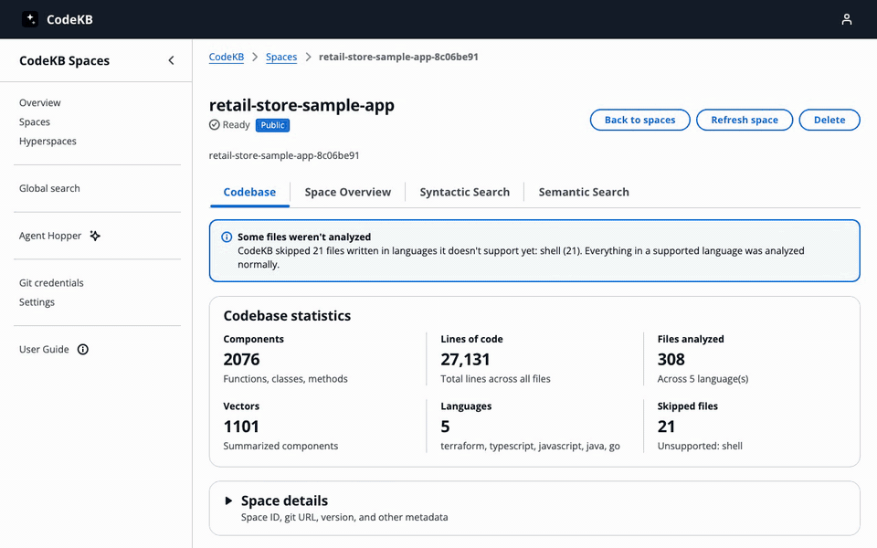
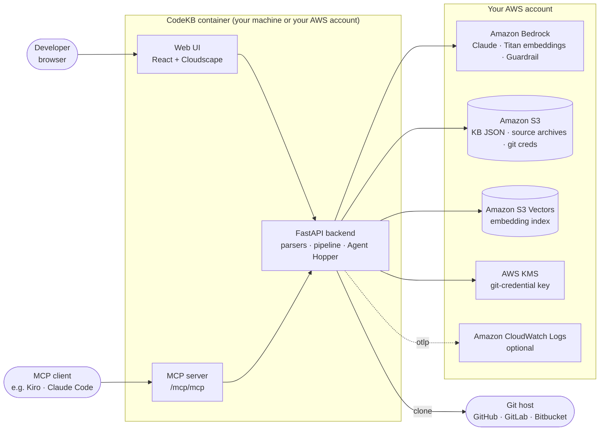

# CodeKB

**Turn any codebase into an explorable knowledge base: semantic search, generated architecture docs, and a repository-aware chat agent, powered by Amazon Bedrock.**

CodeKB points at a Git repository (or a zip upload), parses the code, summarizes it
with Amazon Bedrock, and gives you generated architecture overviews, intent-based
search, and a chat agent grounded in the analyzed code. Durable CodeKB data stays
in AWS resources that you configure; the container can run locally or in your AWS
account and keeps temporary working files on its disk.

---

## What you get

- **Space Overviews:** generated Markdown covering a codebase's business overview,
  application architecture, technology stack, and deployment architecture.
- **Semantic code search:** find components by intent ("where are payments
  authorized?"), not just by keyword.
- **Agent Hopper:** a repository-aware chat agent that answers questions grounded in
  the analyzed code, with an Impact Analysis mode for reasoning about what a change
  would break.
- **Hyperspaces:** group related repositories so search, chat, and overviews can span
  a whole system rather than a single repo.
- **MCP tools:** the same search and analysis exposed to your IDE or AI assistant
  (for example Kiro or Claude Code) over the [Model Context
  Protocol](https://modelcontextprotocol.io).

Each analyzed codebase is a **space**, created from a Git URL or a zip upload. Related
spaces can be grouped into a **hyperspace**.

## How it works

---

## Choose how to run it

| Option | Use it when | Guide |
| --- | --- | --- |
| **Deploy to AWS with CDK** (recommended) | A team needs a shared instance with sign-in. Creates ECS Fargate, CloudFront, AWS WAF and Amazon Cognito in your account. | [Deploying to AWS](docs/deployment.md) |
| **Try it on your machine** | One person evaluating CodeKB. No sign-in, reachable from localhost only. | [Local evaluation](docs/local.md) |

Both need Amazon Bedrock access to a supported Claude model and to Titan Text
Embeddings V2.

## Documentation

| Guide | What's in it |
| --- | --- |
| [Deploying to AWS](docs/deployment.md) | The CDK app, its cost, adopting existing resources, requirements for any deployment, teardown |
| [Local evaluation](docs/local.md) | A single-user run on your machine |
| [MCP](docs/mcp.md) | The MCP tools and how to connect a client |
| [Configuration](docs/configuration.md) | The settings that need a decision, models, and logs |
| [Security](docs/security.md) | Sign-in, space authorization, Git-credential storage, decommissioning |
| [Languages](docs/languages.md) | Supported languages and Dart caveats |
| [FAQ](docs/faq.md) | Cost, sizing, refresh, exclusions, upgrades |
| [Troubleshooting](docs/troubleshooting.md) | Common errors and their fixes |
| [Development](docs/development.md) | Running from source, tests, how the image is built |

---

## Known limitations

- **A space is a snapshot of one branch or tag at one commit.** CodeKB doesn't
  index commit history. Use **Refresh space** to update a Git space. For a zip,
  upload the new archive as a new space.
- **Only supported languages are parsed** (Python, JavaScript, TypeScript, Java,
  Kotlin, Go, Rust, C, C++, C#, PHP, Ruby, Terraform, Dart). Other source files
  are counted and skipped. Tests, build output and AI-agent folders are excluded
  by default.
- **Size limits.** An analysis parses at most 10,000 eligible source files; any
  beyond that are skipped with only a log warning. Files over 10 MB are skipped.
  A Git clone must finish within 5 minutes. A zip upload can be up to 500 MB and
  5 GB once extracted.
- **Built for Claude.** The Qwen response path is experimental. The embedding
  model (Titan Text Embeddings V2) is fixed.
- **Background jobs are capped and run inside the server process.** By default,
  each process runs at most 32 analyses, refreshes and overview generations at once
  (`CODEKB_PIPELINE_POOL_SIZE`); further job requests get HTTP 429 with
  `Retry-After: 60`. If the process restarts mid-job, the space stays in progress.
  On the first detailed status check after 12 hours without progress, CodeKB
  marks it failed. Operations on the same space aren't fully serialized; don't
  refresh, regenerate overviews and delete it at the same time.
- **No TLS termination or general request-rate limiter.** Put CodeKB behind a
  proxy or load balancer that provides them. In the CDK deployment, CloudFront
  terminates TLS and AWS WAF limits each IP address to 1,000 requests per
  5 minutes.

---

## Contributing

Contributions are welcome. Please read **[CONTRIBUTING.md](CONTRIBUTING.md)** and the
**[Code of Conduct](CODE_OF_CONDUCT.md)** before opening an issue or pull request.
Development setup, tests, and build internals are in
**[docs/development.md](docs/development.md)**.

## Security

See [CONTRIBUTING](CONTRIBUTING.md#security-issue-notifications) for how to report a
security issue. For the architecture's trust boundaries and how Git credentials are
protected, see **[docs/security.md](docs/security.md)**.

## License

This project is licensed under the Apache-2.0 License. See [LICENSE](LICENSE).