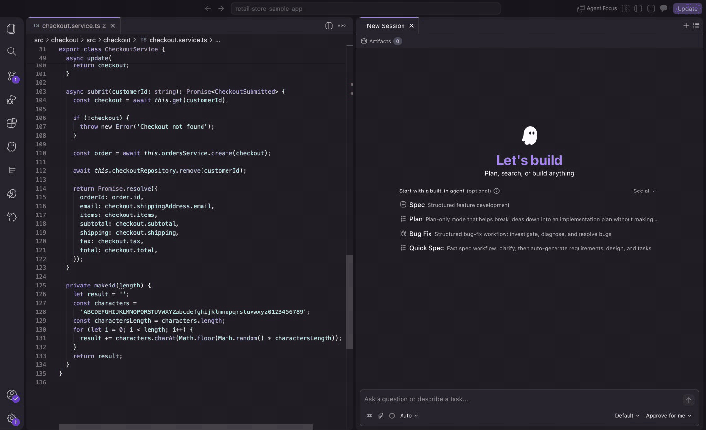
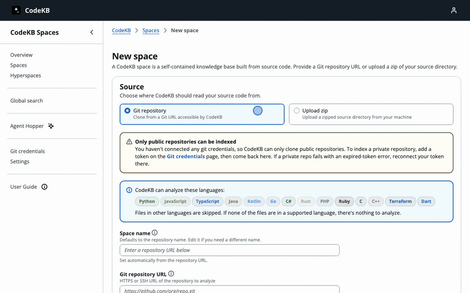
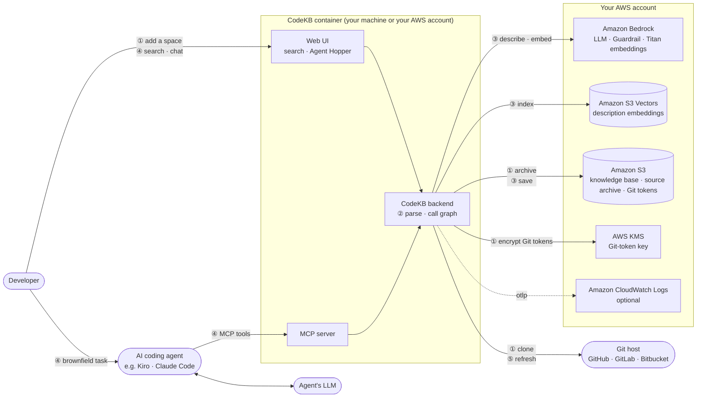

# CodeKB

## Code understanding for the world of autonomous software factories.

**How are you using AI in brownfield development today?**

You probably figure out which repositories a task touches, pull them into a workspace,
and point your agent at them. Then you hope you did not miss one.

That manual process does not scale. In a real enterprise, knowledge of how systems
fit together is tribal. It lives across many people and hundreds or thousands of
repositories. No single person or agent understands how it all fits together.

An autonomous software factory cannot wait for a human to hand-pick repositories for
every task. CodeKB gives you and your factory exactly that. Describe the task, and
CodeKB automatically and reliably selects the relevant repositories from across your
organization, then grounds your agents in how those systems actually work.

This is not limited to impact analysis. The same cross-repository understanding
supports brownfield work throughout the software lifecycle: project planning,
feature development, debugging, refactoring, code reviews, and modernization.

**Not code indexing. Code understanding.**

---

## What you get

- **Space Overviews:** generated Markdown covering a codebase's business overview,
  application architecture, technology stack, and deployment architecture.
- **Semantic code search:** find components by intent ("where are payments
  authorized?"), not just by keyword.
- **Agent Hopper:** a chat agent that answers questions grounded in
  the analyzed code, with an Impact Analysis mode for reasoning about what a change
  would break.
- **Hyperspaces:** group related repositories so search, chat, and overviews can span
  a whole system rather than a single repo.
- **MCP tools:** the same search and analysis exposed to your IDE or AI assistant
  (for example Kiro or Claude Code) over the [Model Context
  Protocol](https://modelcontextprotocol.io).

Each analyzed codebase is a **space**, created from a Git URL or a zip upload. Related
spaces can be grouped into a **hyperspace**.

## How it works

CodeKB runs as one container that serves the web UI, the REST API and the MCP server.
Everything it stores and every model it calls are in your own AWS account. The
numbers in the diagram match the steps below it.

### How CodeKB builds an understanding of a codebase

1. **Add a space.** Point CodeKB at a Git URL or upload a zip. It clones or extracts
   the source and archives a copy in S3. Saved Git tokens are encrypted with a KMS
   key.
2. **Recover deep context.** Tree-sitter parsers extract the symbols in each
   [supported language](docs/languages.md), such as functions, methods, classes,
   modules and variables. CodeKB then rebuilds the call graph between them. Knowing
   which code calls which is what lets CodeKB understand a function in context.
3. **Build the business-behavior index.** This is the core of CodeKB. On top of the
   symbols and the call graph, an LLM on Amazon Bedrock describes each function in
   business language, together with the code it calls. Each description therefore
   says what the function accomplishes through its callees. A Bedrock Guardrail
   masks secrets and PII first, and Titan embeds the descriptions into S3 Vectors.
4. **Search by behavior, then follow the graph.** Because the index is built from
   descriptions of what code does, semantic search finds components by intent
   rather than keyword. From any match, the call-graph tools walk to its source,
   callers and callees, so a single hit becomes a path through the system. Agent
   Hopper and MCP clients such as Kiro use the same tools. Space Overviews are
   generated on demand, and a hyperspace groups related repositories so search,
   chat and overviews span all of them.
5. **Keep it current without rebuilding it.** Refreshing a Git-sourced space
   re-parses only the changed files. It then walks the call graph in reverse to find
   the callers whose descriptions included the changed code, and re-summarizes those
   callers and the changed functions. Everything else is reused. If a refresh fails,
   the last indexed version stays searchable.

---

## Choose how to run it

| Option | Use it when | Guide |
| --- | --- | --- |
| **Deploy to AWS with CDK** (recommended) | A team needs a shared instance with sign-in. Creates ECS Fargate, CloudFront, AWS WAF and Amazon Cognito in your account. | [Deploying to AWS](docs/deployment.md) |
| **Try it on your machine** | One person running CodeKB. No sign-in, reachable from localhost only. | [Local setup](docs/local.md) |

Both need Amazon Bedrock access to a supported Claude model and to Titan Text
Embeddings V2.

## Documentation

| Guide | What's in it |
| --- | --- |
| [Deploying to AWS](docs/deployment.md) | The CDK app, its cost, adopting existing resources, requirements for any deployment, teardown |
| [Local setup](docs/local.md) | A single-user run on your machine |
| [MCP](docs/mcp.md) | The MCP tools and how to connect a client |
| [Configuration](docs/configuration.md) | The settings that need a decision, models, and logs |
| [Security](docs/security.md) | Sign-in, space authorization, Git-credential storage, decommissioning |
| [Languages](docs/languages.md) | Supported languages |
| [FAQ](docs/faq.md) | Cost, sizing, refresh, exclusions, upgrades |
| [Troubleshooting](docs/troubleshooting.md) | Common errors and their fixes |
| [Development](docs/development.md) | Running from source, tests, how the image is built |
| [Roadmap](ROADMAP.md) | What we're working on and planning next |

---

## Known limitations

- **A space is a snapshot of one branch or tag at one commit.** CodeKB doesn't
  index commit history. Use **Refresh space** to update a Git space. For a zip,
  upload the new archive as a new space.
- **Only supported languages are parsed** (Python, JavaScript, TypeScript, Java,
  Kotlin, Go, Rust, C, C++, C#, PHP, Ruby, Terraform, Dart). Other source files
  are counted and skipped. Tests, build output and AI-agent folders are excluded
  by default.
- **Size limits.** An analysis parses at most 10,000 eligible source files; any
  beyond that are skipped with only a log warning. Files over 10 MB are skipped.
  A Git clone (shallow, latest commit only) must finish within 5 minutes. A zip
  upload can be up to 500 MB and 5 GB once extracted.
- **Background jobs are capped and run inside the server process.** By default,
  each process runs at most 32 analyses, refreshes and overview generations at once
  (`CODEKB_PIPELINE_POOL_SIZE`); further job requests get HTTP 429 with
  `Retry-After: 60`. If the process restarts mid-job, the space stays in progress.
  On the first detailed status check after 12 hours without progress, CodeKB
  marks it failed. Operations on the same space aren't fully serialized; don't
  refresh, regenerate overviews and delete it at the same time.
- **No TLS termination or general request-rate limiter.** Put CodeKB behind a
  proxy or load balancer that provides them. In the CDK deployment, CloudFront
  terminates TLS and AWS WAF limits each IP address to 1,000 requests per
  5 minutes.

---
## Maintainers

| Maintainer        | GitHub ID                                                 | 
| ----------------- | --------------------------------------------------------- | 
| Raj Jain          | [raj-jain-dev](https://github.com/raj-jain-dev)           | 
| Raja SP           | [spraja08](https://github.com/spraja08)                   | 
| Anurag V. Singh   | [AnuragVikramSingh](https://github.com/AnuragVikramSingh) | 

## Contributing

Contributions are welcome. Please read **[CONTRIBUTING.md](CONTRIBUTING.md)** and the
**[Code of Conduct](CODE_OF_CONDUCT.md)** before opening an issue or pull request.
Development setup, tests, and build internals are in
**[docs/development.md](docs/development.md)**.

## Security

See [CONTRIBUTING](CONTRIBUTING.md#security-issue-notifications) for how to report a
security issue. For the architecture's trust boundaries and how Git credentials are
protected, see **[docs/security.md](docs/security.md)**.

## License

This project is licensed under the Apache-2.0 License. See [LICENSE](LICENSE).
