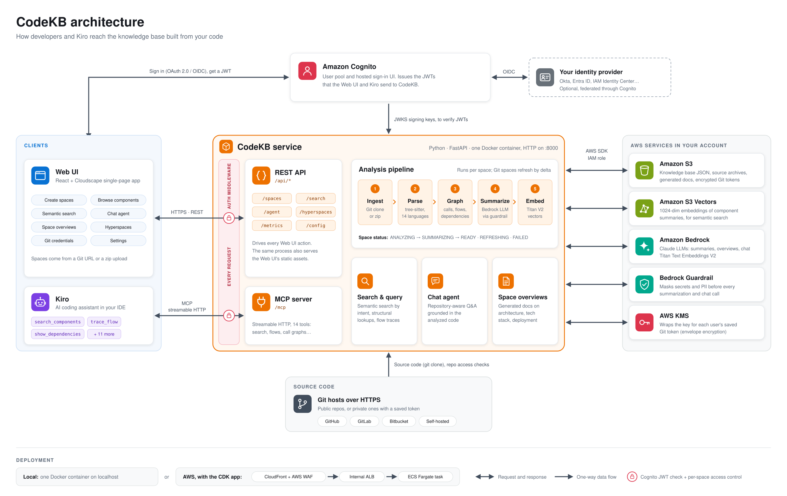

# Deploying to AWS

The CDK app in `infra/cdk/` deploys CodeKB as a shared service with sign-in:
ECS Fargate behind an internal Application Load Balancer, fronted by CloudFront
and AWS WAF, with an Amazon Cognito user pool that can federate to your own OIDC
provider. It builds the container image from this repository.



## Cost

> [!IMPORTANT]
> The default `alpha` stage and every stage except `dev` run **10 Fargate tasks
> of 4 vCPU and 16 GB each**. `dev` runs one. Review this before deploying. To
> change the count, edit `containerCount` in `infra/cdk/src/config/env.ts`.

Bedrock usage is the main workload-dependent cost. The deployment also incurs
Fargate, load balancer, CloudFront, WAF, log, storage, KMS and Cognito charges.
Estimate your configuration with the
[AWS Pricing Calculator](https://calculator.aws/) and see [the FAQ](faq.md#how-much-does-codekb-cost-to-run)
for Bedrock cost drivers.

## Prerequisites

- Node.js and npm, the AWS CLI, and a running Docker (or finch, with
  `export CDK_DOCKER=finch`). The image is built on your machine.
- Bedrock access in `CODEKB_BEDROCK_REGION` (default `us-east-1`) to the model you
  deploy with (default Claude Opus 4.6) and to Titan Text Embeddings V2.
- Credentials for the target account, for example `export AWS_PROFILE=<profile>`.
  Confirm the account and role with `aws sts get-caller-identity` before deploying.
- A one-time CDK bootstrap in your deploy region and in `us-east-1`, where the WAF
  and, by default, the guardrail live. If `CODEKB_BEDROCK_REGION` differs from
  both, bootstrap that region too.

  ```bash
  npx cdk bootstrap aws://<account-id>/<deploy-region>
  npx cdk bootstrap aws://<account-id>/us-east-1
  # Only when Bedrock uses a third region:
  npx cdk bootstrap aws://<account-id>/<bedrock-region>
  ```

## Deploy

From the repository root:

```bash
CODEKB_STAGE=prod CODEKB_REGION=us-east-1 ./scripts/deploy.sh
```

`CODEKB_REGION` is required. The script prints the resolved settings before it
creates anything and the app URL at the end. It deploys the stacks in phases,
then redeploys Auth and Service after CloudFront provides the real host name for
the Cognito callback URLs. `npm run deploy` in `infra/cdk/` runs the same script.

In a new account this creates the storage and a Cognito user pool. Create your
first user with the commands the script prints:

```bash
aws cognito-idp admin-create-user --user-pool-id <id> --username <email> \
  --user-attributes Name=email,Value=<email> Name=email_verified,Value=true --region <region>
aws cognito-idp admin-set-user-password --user-pool-id <id> --username <email> \
  --password '<password>' --permanent --region <region>
```

Verify the deployment before sharing it:

1. Open the app URL and sign in as the user you created.
2. Confirm `curl -i https://<host>/api/health` returns 200.
3. Confirm an anonymous `curl -i https://<host>/api/spaces` returns 401. Stop if
   it returns data.
4. Create a small public-repository space and confirm it reaches **Ready**.

To connect an MCP client, see [MCP](mcp.md). Use the app URL the script printed.

### Reuse existing storage or a user pool

Export these before running the script. CloudFormation imports the existing
buckets, vector index and user pool without taking ownership. The deployment does
create and own its web and MCP app clients inside a reused pool.

```bash
# Existing storage: all three, or none
export CODEKB_S3_BUCKET=my-kb-bucket
export CODEKB_S3_VECTORS_BUCKET=my-vectors-bucket
export CODEKB_S3_VECTORS_INDEX=my-index

# Existing Cognito pool: both, or neither
export CODEKB_COGNITO_USER_POOL_ID=us-east-1_abc123
export CODEKB_COGNITO_DOMAIN_URL=https://my-pool.auth.us-east-1.amazoncognito.com
```

With an existing pool, the deploy adds and owns its web and MCP app clients and
registers their callback URLs. It doesn't alter pool settings, users, federation,
or existing clients.

### Upgrade

Pull the latest source, compare the new settings with the environment variables
you use, and run the script again with the same deployment identity and stage.
Existing spaces normally remain usable because upgrades don't rewrite them. If an
older Git space fails to load, refresh it; recreate an older zip space from its
archive.

Existing hyperspace overviews without a recorded document ETag must be regenerated
once. Their read endpoint returns 409 with a regeneration message until then.
Changing a hyperspace's members also clears its overview; generate a new one for
the updated membership.

## Stacks

Stacks are named `<prefix>-<component>`. The prefix is `CODEKB_PROJECT`
lowercased with a leading `aws` removed, plus the stage, so the defaults give
`codekb-alpha`.

| Stack | Contents |
| --- | --- |
| `…-storage` | Knowledge-base bucket, S3 access-log bucket, and S3 Vectors index. Skipped when you reuse storage. Retained on delete |
| `…-auth-secret` | Secrets Manager secret for an OIDC client secret. Only with OIDC federation on a new pool. Retained on delete |
| `…-auth` | Web and MCP app clients; for a new deployment, also the Cognito user pool and hosted-UI domain. With a reused pool, imports the pool and creates only the clients |
| `…-guardrail` | Bedrock guardrail, in `CODEKB_BEDROCK_REGION` |
| `…-service` | ECS Fargate service, internal ALB, KMS key for Git tokens |
| `…-waf` | CloudFront WebACL, in `us-east-1`. Includes a limit of 1,000 requests per 5 minutes per IP address |
| `…-certificate` | ACM certificate, in `us-east-1`. Only with a custom domain |
| `…-edge` | CloudFront distribution |

Logs go to CloudWatch Logs in the deploy region: `/ecs/<prefix>/otel` for CodeKB
and `/ecs/<prefix>/service` for the container's output.

## Settings

The deploy does **not** read `.env`. It reads the key variables below from your
shell; the reuse and OIDC sections above list the variables for those paths.
Stage-profile values in `infra/cdk/src/config/env.ts` supply the default model and
Bedrock region, allowed Git hosts (`github.com`), summarization concurrency, task
count, and old-object retention.

| Variable | Default | Meaning |
| --- | --- | --- |
| `CODEKB_REGION` | required | Region to deploy into |
| `CODEKB_STAGE` | `alpha` | Stage name. `dev` selects the `dev` profile; anything else uses `default` |
| `CODEKB_PROJECT` | `AwsCodeKb` | Stack name prefix |
| `CODEKB_BEDROCK_REGION` | `us-east-1` | Region for Bedrock calls and the guardrail. Must offer your model |
| `CODEKB_BEDROCK_MODEL_ID` | from the profile | Default model for every workload. Its prefix (`us.`, `eu.`, ...) must match `CODEKB_BEDROCK_REGION` |
| `CODEKB_LLM_*`, `CODEKB_<WORKLOAD>_*` | unset | Thinking, effort and per-workload models; see [Configuration](configuration.md#thinking-effort-and-per-workload-models) |
| `CODEKB_REQUIRE_AUTHORIZATION` | `true` | `false` lets every signed-in user open every space |
| `CODEKB_BEDROCK_GUARDRAIL_ENABLED` | `true` | `false` skips the guardrail and sends source to Bedrock unredacted. Not recommended |
| `CODEKB_DOMAIN_NAME`, `CODEKB_HOSTED_ZONE_NAME` | unset | Custom domain. Both required. Creates the certificate and a Route 53 alias |
| `CODEKB_CALLBACK_DOMAIN` | the CloudFront host | Host the Cognito callback URLs use. Set it when users reach CodeKB on another host name |
| `CODEKB_LOG_LEVEL` | `INFO` | `DEBUG`, `INFO`, `WARNING` or `ERROR` |
| `CODEKB_LOG_PAYLOAD_MAX` | `4000` | Characters logged per payload at `DEBUG`. `0` uncaps payload dumps, which can include source code |
| `CODEKB_COGNITO_REGION`, `CODEKB_COGNITO_IDP_NAME` | unset | For a reused pool: its region, and a federated provider to send users to |
| `CODEKB_COGNITO_PREFIX` | `<prefix>-<account>` | Hosted-UI domain prefix for a new pool. Must be unique in the region |
| `CODEKB_ALLOW_LOCALHOST_REDIRECTS` | unset | `true` adds `http://localhost:5173` callbacks, for UI development. Never in production |

### OIDC federation

To federate a new pool to your identity provider, set `CODEKB_OIDC_CLIENT_ID`
and `CODEKB_OIDC_ISSUER`. Optional: `CODEKB_OIDC_PROVIDER_NAME` (default
`OidcIdP`), `CODEKB_OIDC_ATTRIBUTE_MAPPING` (JSON), and `CODEKB_OIDC_ONLY=true` to
allow only federated users.

The client secret is never an environment variable. On the first deploy the
script creates an empty secret, `<prefix>-oidc-client-secret`, and waits for you
to press Enter. Store your provider's secret in it first:

```bash
aws secretsmanager put-secret-value --secret-id <prefix>-oidc-client-secret \
  --region <region> --secret-string '<client-secret>'
```

Without a terminal the script stops instead; store the secret, then re-run with
`CODEKB_OIDC_SECRET_READY=true`.

## Other commands

From `infra/cdk/`: `npm run build`, `npm run lint`, `npm run format`, and the CDK
CLI (`npx cdk list`, `npx cdk diff <stack>`). Deploy with the script rather than
`npx cdk deploy`: it passes the Cognito values the Web UI is built with, and
without them the UI has no sign-in.

## Requirements for any deployment

The CDK app is the supported way to run a shared instance. If you change it, or
run the container on other infrastructure, keep everything below. Skipping any of
these items leaves a security gap, not just a broken deploy.

### Sign-in

1. A Cognito user pool with a hosted-UI domain. Federate other identity providers
   into it over OIDC or SAML.
2. Two app clients without a client secret, with the authorization code grant and
   the `openid`, `email` and `profile` scopes:

   | Client | Callback URLs | Sign-out URL |
   | --- | --- | --- |
   | Web | `https://<host>/auth/callback`, `https://<host>` | `https://<host>` |
   | MCP | `https://<host>/oauth2/callback` | `https://<host>` |

3. These settings on the container:

   ```bash
   CODEKB_REQUIRE_AUTHENTICATION=true
   CODEKB_COGNITO_USER_POOL_ID=<region>_<id>
   CODEKB_COGNITO_APP_CLIENT_IDS=<web-client-id>,<mcp-client-id>
   CODEKB_COGNITO_DOMAIN_URL=https://<prefix>.auth.<region>.amazoncognito.com
   CODEKB_COGNITO_MCP_CLIENT_ID=<mcp-client-id>
   CODEKB_PUBLIC_DOMAIN=<host>
   # CODEKB_COGNITO_REGION=<region>   if the pool is not in CODEKB_S3_REGION
   # CODEKB_COGNITO_IDP_NAME=<name>   to skip the provider picker
   ```

4. An image built with `VITE_AUTH_ENABLED=true`, `VITE_COGNITO_DOMAIN` and
   `VITE_COGNITO_CLIENT_ID=<web-client-id>`. Without them the UI has no sign-in.

If the pool ID or the client IDs are missing, protected `/api` routes and the
MCP endpoint return 503. Never turn sign-in off behind an authenticating proxy
instead: CodeKB ignores the proxy's identity headers and, with sign-in off,
trusts whatever identity the caller sends.

### Network

- Terminate TLS at a proxy or load balancer and forward HTTP to port 8000. Make
  port 8000 reachable from that proxy only.
- Health check: `GET /api/health` returns 200.
- Agent Hopper streams answers as server-sent events. Don't buffer them, and allow
  responses that last several minutes.
- Rate-limit at the edge, as the WAF stack does.
- Under a path prefix, set `CODEKB_ROOT_PATH=/codekb` and build with
  `VITE_BASE=/codekb/`, and include the prefix in the callback URLs.
- Outbound access: see [Security → Network access](security.md#network-access).

### AWS access

Run the container under a role (ECS task role, EKS pod identity, EC2 instance
profile) with the permissions in `CodeKBAccessPolicy`; see
[what `setup_aws.sh` creates](local.md#what-setup_awssh-creates). Avoid long-lived
access keys. Give each task disk for its largest repository under `/tmp/codekb`;
the CDK sizes tasks at 4 vCPU, 16 GB and 50 GiB.

### Replicas

- Use sticky sessions. The MCP sign-in handshake is held in the memory of the
  replica that started it; the CDK uses a 10-minute load balancer cookie.
- `CODEKB_PIPELINE_POOL_SIZE` limits background jobs per replica, not in total.
- After one replica refreshes a space, another can serve its cached version for up
  to `CODEKB_SOURCE_CACHE_REFRESH_CHECK_TTL_HOURS` (4 hours by default).
- Operations on the same space aren't fully serialized across requests. Don't
  refresh, regenerate overviews and delete a space concurrently.
- A replica that stops mid-analysis leaves that space in progress. On the first
  detailed status check after 12 hours without progress, CodeKB marks it failed.
  Drain replicas before upgrades where you can.

## Tear down

`cdk destroy` leaves retained resources in place: the knowledge-base and access-log
buckets, vector resources, Git-credentials KMS key, OIDC secret (when used), and
a CodeKB-created user pool. With a reused pool, destroy removes only the app
clients this deployment added. To remove retained data and keys, follow
[Decommissioning](security.md#decommissioning); don't delete resources that CodeKB
only reused.
