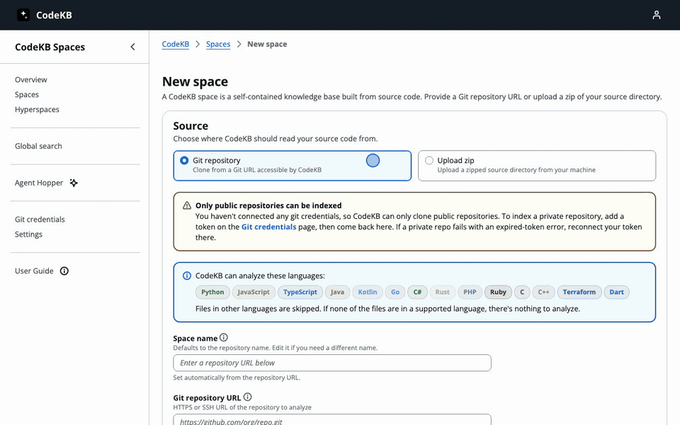

# Local setup

This page runs CodeKB for **one person on their own machine**, with sign-in
turned off and the port reachable from localhost only. Use it to run CodeKB
locally. For anything other people can reach, use [Deploying to AWS](deployment.md).

With sign-in off, requests aren't authenticated. A caller can choose any identity
through an unsigned token or header, so anyone who can reach the port can act as
another user. The commands below publish the port on `127.0.0.1` only; keep it
that way.

## Prerequisites

- Linux or macOS, Git, Docker (or finch), and AWS CLI v2 with S3 Vectors
  support (`aws s3vectors create-vector-bucket --generate-cli-skeleton` should
  print JSON; it makes no AWS call).
- An AWS account where you can create the resources in step 3.
- Amazon Bedrock access to a Claude model (Claude Opus 4.6 is the default) and to
  Titan Text Embeddings V2, in the region you will use.

## 1. Configure

```bash
git clone https://github.com/awslabs/codekb && cd codekb
cp .env.example .env
```

In `.env`, replace every `<...>` placeholder (account ID, regions, bucket names)
and set:

```bash
CODEKB_REQUIRE_AUTHENTICATION=false
```

Leave `CODEKB_BEDROCK_GUARDRAIL_ID` for step 3. The comments in `.env.example`
describe every other setting; the defaults suit a local setup.

## 2. Sign in to AWS

For a non-default profile, first run `export AWS_PROFILE=my-profile`.

```bash
aws configure          # or: aws sso login
aws sts get-caller-identity
```

## 3. Create the AWS resources

```bash
./infra/cli/setup_aws.sh
```

The script creates the buckets, the vector index, a KMS key, a Bedrock guardrail
and an IAM policy named `CodeKBAccessPolicy`. At the end it prints:

- an `aws iam attach-user-policy` or `attach-role-policy` command. Run the one
  that matches your identity;
- the guardrail ARN. Uncomment `CODEKB_BEDROCK_GUARDRAIL_ID` in `.env` and paste
  it there (required);
- the KMS key ARN. Uncomment `CODEKB_GIT_CREDENTIALS_KMS_KEY_ARN` and paste it
  there if you want to analyze private repositories.

See [what `setup_aws.sh` creates](#what-setup_awssh-creates) for details and the
permissions it needs.

## 4. Run

```bash
./scripts/run-container.sh       # add: finch, or --arch amd64|arm64
```

The script builds the image for your machine's architecture and runs it in the
foreground on `127.0.0.1:8000`. It passes your AWS credentials through
(exported keys, `~/.aws`, or an instance role). Press Ctrl-C to stop it. The
first build takes several minutes.

## 5. Analyze a repository

Open <http://localhost:8000> and click **New space**. Paste an HTTPS Git URL
(its host must be in `CODEKB_ALLOWED_GIT_HOSTS`) or upload a zip. For a private
repository, first save a personal access token on the **Git credentials** page.



The space moves through **Analyzing → Summarizing → Ready**. Then open it to
search it and chat with Agent Hopper, and click **Generate overview** for its
Space Overviews.

To connect an IDE or AI assistant, see [MCP](mcp.md).

## Upgrade

```bash
git pull
./scripts/run-container.sh
```

Compare `.env.example` with your `.env` first and copy over any new settings.
Existing spaces normally remain usable because upgrades don't rewrite them. If
an older Git space fails to load, refresh it; recreate an older zip space from
its archive.

## What setup_aws.sh creates

The script uses the names and regions in `.env` and is intended for resources
dedicated to this CodeKB installation. A rerun skips resources that already
exist, but reapplies the bucket's public-access block, encryption, policy and
CORS; updates the guardrail and managed IAM policy; and enables KMS rotation.
Don't point it at shared or manually managed resources unless those changes are
intended.

The IAM policy name (`CodeKBAccessPolicy`), KMS alias
(`alias/codekb-git-creds-kek`), guardrail name (`codekb-secret-redaction`) and log
group (`/codekb/otel`) are fixed in the script and aren't configurable. If your
account already has any of them, a run updates the policy and guardrail in place
and reuses the KMS key and log group. To run a second installation in the same
account and region, edit those names in `infra/cli/setup_aws.sh` first (and
`OTEL_EXPORTER_OTLP_HEADERS` in `.env` if you rename the log group).

| Resource | Notes |
| --- | --- |
| S3 bucket | Knowledge bases, source archives and saved Git tokens. Public access blocked, default encryption, TLS-only bucket policy |
| S3 Vectors bucket and index | Embeddings |
| KMS key | Encrypts saved Git tokens. Key rotation on |
| Bedrock guardrail | Attempts to anonymize configured PII categories and credential patterns before text reaches the model. Created in `CODEKB_BEDROCK_REGION` |
| CloudWatch log group `/codekb/otel` | Used only if you send logs to CloudWatch |
| IAM policy `CodeKBAccessPolicy` | Created, not attached |

Never delete or replace the KMS key once tokens are saved: they become unreadable.

`CodeKBAccessPolicy` allows object read, write, list and delete on the bucket;
vector operations on the index; `InvokeModel` on Claude models, their inference
profiles and Titan Text Embeddings V2; `ApplyGuardrail`; writes to the log group;
and `GenerateDataKey`, `Decrypt` and `DescribeKey` on the KMS key. It also denies any model call
that doesn't carry the guardrail. The supplied policy supports Claude; a different
model needs a corresponding model ARN in the allow statement.

If you sign in through IAM Identity Center, you can't attach the policy to your
`AWSReservedSSO_*` role. Ask an administrator to add it to your permission set.

<details>
<summary>Permissions needed to run <code>setup_aws.sh</code></summary>

- S3: `s3:CreateBucket`, `s3:ListBucket`, `s3:PutBucketCors`,
  `s3:PutBucketPublicAccessBlock`, `s3:PutEncryptionConfiguration`,
  `s3:PutBucketPolicy`
- S3 Vectors: `s3vectors:CreateVectorBucket`, `s3vectors:GetVectorBucket`,
  `s3vectors:CreateIndex`, `s3vectors:GetIndex`
- KMS: `kms:CreateKey`, `kms:CreateAlias`, `kms:DescribeKey`, `kms:EnableKeyRotation`
- CloudWatch Logs: `logs:CreateLogGroup`
- Bedrock: `bedrock:CreateGuardrail`, `bedrock:ListGuardrails`, `bedrock:UpdateGuardrail`
- IAM (script): `iam:CreatePolicy`, `iam:GetPolicy`, `iam:CreatePolicyVersion`,
  `iam:ListPolicyVersions`, `iam:DeletePolicyVersion`
- IAM (to run the attach command printed afterward): `iam:AttachUserPolicy` or
  `iam:AttachRolePolicy`

</details>
